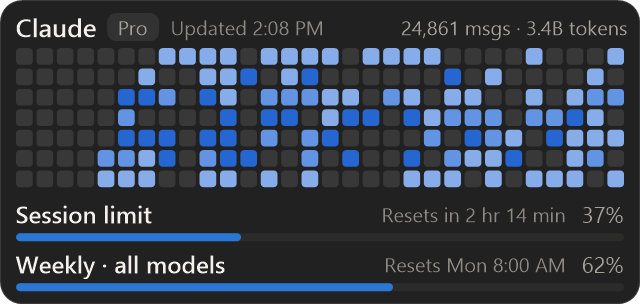

# Claude Lock Widget

**Your Claude Code usage as a real Windows 11 lock screen widget.**

Add it from *Settings > Personalization > Lock screen > Widgets* like Weather or Focus session. It shows Claude Code's two usage panels - the **activity calendar** (`/stats`) on top and the **plan limit bars** (Session / Weekly) below - and refreshes **after every task Claude finishes**. Your wallpaper and lock screen picture are never touched.



> The picture uses built-in sample data (`preview.cmd -Demo`).

## Why it exists

Claude Code shows your limits only inside the app. If you are away from the terminal and just want to know "do I have budget left for this afternoon?", the lock screen is the one place you always glance at.

## Features

- **A real lock screen widget** - a packaged Windows widget provider, listed in the lock screen widget picker next to the built-in ones.
- **Same data as Claude Code** - Sessions, Messages, Tokens, Active days, Peak hour, Favorite model and the 26-week calendar (computed exactly like `/stats`), plus *Session limit* and *Weekly - all models* with reset times.
- **Updates after every task** - an async Claude Code `Stop` hook refreshes your stats, and Claude pushes your live plan usage (read from the desktop app's own `get_usage`) at the end of each task. Works in the **Claude desktop app**, the terminal and IDEs.
- **No secrets involved by default** - the numbers come from Claude itself; the widget never needs your login token (an opt-in fallback exists, off by default).
- **Reversible** - `uninstall.cmd` removes the widget, the hook and the note it added; everything else in your settings is left as it was (a backup is written before any edit, and the JSON may be re-indented).
- **Zero runtime dependencies** - Windows PowerShell 5.1 (built in) for the data side, a self-contained package for the widget. No Python, Node or .NET to install.

## Quick start

1. Use Claude Code on this PC at least once (so there are stats to show).
2. Download the latest release ZIP and unzip it anywhere. *(Building from source: see [widget/README.md](widget/README.md).)*
3. Double-click **`install.cmd`** and answer **Y** to "Update the widget after every Claude task?". Approve the one Windows admin prompt - it only trusts the widget's own signing certificate.
4. Open *Settings > Personalization > Lock screen > Widgets > Add widget* and pick **Claude usage**.
5. Press <kbd>Win</kbd>+<kbd>L</kbd>.

Details, options and troubleshooting: **[Setup Guide](SETUP_GUIDE.md)**. To see your real data without installing anything, double-click **`preview.cmd`**.

## How it works

```
 Claude finishes a task
   |-- Stop hook (async) ------------> ClaudeLockWidget.ps1 hook ------------+
   '-- Claude calls get_usage and runs -> push-usage  (plan limits) ---------+
                                                                             v
 ~/.claude/projects/*.jsonl --> stats      %LOCALAPPDATA%\ClaudeLockWidget\widget\
                                           widget-state.json + tile PNG
                                                       |  (file watcher)
                                                       v
                     Windows widget provider (packaged, COM) --> lock screen widget
```

- The **provider** is a tiny out-of-process COM server that Windows starts when the widget is shown. It only displays what the PowerShell side publishes - no logic, no network.
- Plan usage comes from, in order of freshness: Claude's push after a task, Claude Code's **status line** feed (`rate_limits`, terminal/IDE), and - only if you enable `apiFallback` - Anthropic's usage endpoint with your Claude Code login file.
- The desktop app keeps its login in memory and never writes `~/.claude/.credentials.json`, which is why a token-based tool can't see your usage there. Asking Claude is the supported way.

### Why not an MCP server?

MCP lets an assistant call tools; it can't paint on the lock screen or push data on a schedule. (This project does lean on one MCP tool - the desktop app's `get_usage` - as a *data source*.)

## Requirements

- Windows 11 with lock screen widgets (Settings > Lock screen > **Widgets** exists; recent 24H2/25H2 builds). Any edition, including Home.
- Windows PowerShell 5.1 (included in Windows)
- Claude Code (desktop app, terminal or IDE) with a Pro/Max/Team plan for the limit bars

## Configuration

`%LOCALAPPDATA%\ClaudeLockWidget\config.json` controls calendar length, stat range, bar list and colours - see the [Setup Guide](SETUP_GUIDE.md#customising).

## Privacy and security

- Reads `~/.claude/projects/**/*.jsonl` for **counts only** (timestamps, model, token usage). Message text is never stored or sent anywhere.
- Edits `~/.claude/settings.json` (adds one hook, with a backup) and `~/.claude/CLAUDE.md` (adds one marked block) **only** if you say yes during install.
- Makes **no network requests** in the default configuration. With `apiFallback` on it sends your Claude Code login token to `api.anthropic.com` only.
- The lock screen is visible to anyone at your PC; the widget shows totals and percentages, not prompts or code.

Details and how to report a vulnerability: [SECURITY.md](SECURITY.md).

## Limitations

- Lock screen widgets must be **small** and Windows controls their size and placement (up to four, in a row at the bottom). The widget is a single tile that fits the calendar and both bars; on the Widgets board (Win+W) it scales to the medium size too.
- Windows only installs the widget package if it trusts its certificate, which needs one admin approval. A Microsoft Store listing would remove that step.
- Plan usage after a task depends on Claude following the short note in `CLAUDE.md`; if a run is skipped, the widget keeps the last values and marks them stale after 6 hours.
- Claude's usage endpoint (fallback only) is undocumented and can change.

## Development

```powershell
powershell -NoProfile -ExecutionPolicy Bypass -File tests\run-tests.ps1                 # tests, a few seconds
powershell -NoProfile -ExecutionPolicy Bypass -File src\ClaudeLockWidget.ps1 preview -Demo
powershell -NoProfile -ExecutionPolicy Bypass -File widget\Build-Widget.ps1             # build + sign the package
```

See [CONTRIBUTING.md](CONTRIBUTING.md).

## Disclaimer

Unofficial community project. Not affiliated with, endorsed by, or sponsored by Anthropic or Microsoft. "Claude" and "Claude Code" are trademarks of Anthropic, PBC. The UI is a re-creation for personal use.

## License

[MIT](LICENSE)
